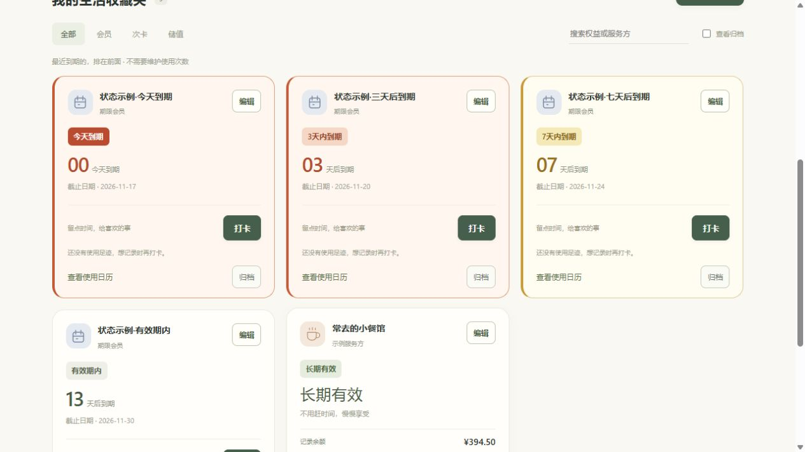

# 余 · 权益清单

**把分散的权益变成到期清单，把一句口述变成可核对的使用记录。**


余是一款可独立部署的浏览器端权益管理工具。通过统一到期视图、语音辅助记录和使用日历，连接“记得自己拥有什么”与“把权益实际用起来”。采用原生JavaScript与ES Modules，无第三方前端运行依赖。

这是一次从真实需求到工程交付的AI协作实践：除了产品取舍，还包含中文金额规则解析、异步语音会话管理、记录一致性保护、自动回归检查和线上部署。

[技术架构](docs/architecture.md) · [工程问题与解决过程](docs/engineering.md) · [产品案例](docs/product-case.md) · [后续规划](docs/roadmap.md)

## 界面预览



12版历史验收截图，使用示例数据展示今天、3天内、7天内及长期有效等状态；截图中的日期和余额不代表实时数据或个人真实账户。

## 产品入口

[线上版本](https://yu-benefits-list-20261118.knitamber.chatgpt.site)

当前线上版本仅所有者可访问，尚未开放公众访问。其他访问者可以按下方步骤本地运行，使用首页“先体验示例清单”体验完整流程。

## 为什么做

骑行卡、健身会员和餐饮储值分散在不同App或小程序中。每次查看都需要进入对应平台、寻找具体入口，容易忘记自己拥有哪些权益及其到期时间。

首版聚焦一个任务：在统一清单中找到即将到期的权益，帮助用户安排使用或考虑续费。相较通用文本记录，产品自动计算剩余天数、按到期顺序组织信息，并突出临期状态。

## 已实现

- 权益录入、编辑、搜索与分类；支持会员、次卡和储值卡。
- 到期排序及今天、3天内、4—7天等状态分层；未知截止日期与长期有效分开呈现。
- 储值金额记录与校正；次卡不展示或要求维护剩余次数。
- 统一打卡面板，支持语音回填、手动输入、修改后确认保存。
- 使用足迹日历、记录撤销、权益归档与恢复。
- 浏览器本地保存与显式示例模式。

## 实现亮点

| 技术问题 | 当前实现 | 代码入口 |
| --- | --- | --- |
| 一句话里有多个金额，也有总额和明细 | 中文数字与元角分转换；按消费语境提取金额；识别“其中”等总分关系，避免重复相加 | [voice.mjs](dist/voice.mjs) |
| 浏览器会多次返回累计语音结果 | 每次重建当前会话文本，分开处理中间结果和最终结果；支持跨会话继续补充 | [speech-session.mjs](dist/speech-session.mjs) |
| 手动修改后，旧识别回调仍可能到达 | 使用会话token作废旧回调，手动编辑清理语音草稿；待确认内容不直接保存 | [voice-ui.mjs](dist/voice-ui.mjs) |
| 金额精度、撤销与过期表单覆盖 | 金额以整数分保存；撤销检查revision；提交前比对本地存储快照 | [domain.mjs](dist/domain.mjs)、[app.js](dist/app.js) |
| 临期、过期和未知日期容易混淆 | 将日期计算、状态分层、排序与概览集中为纯函数；按日历日期计算天数差 | [expiry.mjs](dist/expiry.mjs) |

例如，储值卡记录支持以下语义，并在回填后由用户确认：

| 输入 | 处理结果 |
| --- | --- |
| 吃饭花了20，饮料4 | 合计24元，保留完整原话 |
| 消费35.5，其中吃饭30，饮料5.5 | 核对总额与明细，只记35.5元 |
| 现在还剩两百块 | 校正余额为200元，与消费记录区分 |
| 总额与明细冲突、消费与余额混在一句 | 提示核对，不生成可直接保存的更新 |

这里的“智能”来自受约束的规则解析与交互确认：浏览器承担语音转写，应用承担结构化解析、业务校验和回填，不依赖大模型API。

## 从需求到可运行原型的推进

我负责问题定义、需求优先级、范围取舍、交互评审与验收，并通过实际使用定位语音缺陷、提供失败原话、确认预期行为，结合朋友试用反馈推动迭代。AI协助技术调研、界面与代码实现、自动检查及文档整理。

技术参与通过具体案例呈现：发现“多个金额”和“金额后补充描述”无法正确处理，将问题细化为多笔合计、总额与明细、跨会话补充等场景，再根据实际体验验收修复。代码和测试展示最终实现，个人贡献不表述为独立编写所有模块。

最关键的取舍是：在无法保证服务方自动同步的条件下，舍去需要持续维护的剩余次数，将首版收敛为到期清单，接受权益信息不完整的代价。储值金额能力保留。

收到期限状态和按钮不够清晰的反馈后，优先加强到期风险表达，并保留使用者认可的生活感视觉。语音迭代基于实际失败语句，例如“消费35.5，其中吃饭30，饮料5.5”，处理总额与明细的重复计算。

- [产品案例与验证结果](docs/product-case.md)
- [模块架构与数据模型](docs/architecture.md)
- [工程问题、解决过程与测试依据](docs/engineering.md)
- [首版需求与验收条件](docs/requirements.md)
- [后续规划与验证问题](docs/roadmap.md)

## 本地运行

项目为原生HTML、CSS和JavaScript，无需安装前端依赖。需要Python 3提供静态服务：

```sh
python -m http.server 5181 --directory dist
```

打开 `http://localhost:5181`。若端口被占用，可将5181改为其他端口。请使用HTTP服务访问，不要直接双击HTML文件，以免模块加载受限。

## 检查

使用Node.js 22运行：

```sh
node --test tests/domain.test.mjs tests/expiry.test.mjs tests/voice.test.mjs tests/speech-session.test.mjs tests/voice-ui.test.mjs
```

当前50项自动检查通过，涵盖日期状态、记录规则、金额解析和模拟语音事件。模拟事件检查不代表真实语音转写准确率。

## 技术与数据边界

- 原生ES Modules；localStorage保存权益与使用记录，无后端或账号系统。
- 语音使用浏览器SpeechRecognition或webkitSpeechRecognition及规则解析；依赖浏览器支持、麦克风权限和识别服务可用性。不可用时可手动输入。
- 点击语音输入后才请求麦克风；浏览器识别服务可能联网处理音频，应用不保存录音。
- 更换浏览器、域名、设备或清理浏览器数据，记录不会自动迁移，可能丢失。
- 临期提示在打开页面时显示；尚无后台主动通知、服务方同步、跨设备同步或App入口跳转。

## 目录

```text
dist/       可独立部署的静态网页
tests/      Node内置测试
docs/       产品案例、架构、工程案例、需求与后续规划
.github/    自动检查配置
```

可将dist目录部署至支持HTTPS的静态托管服务。此仓库不包含个人浏览器数据、试用原始记录或线上托管凭据。
