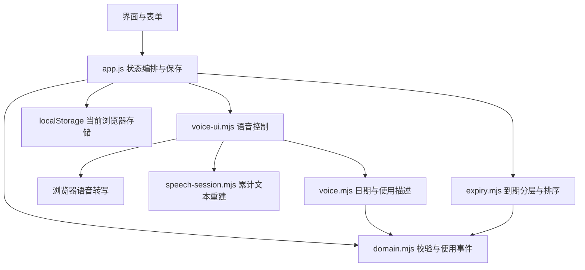
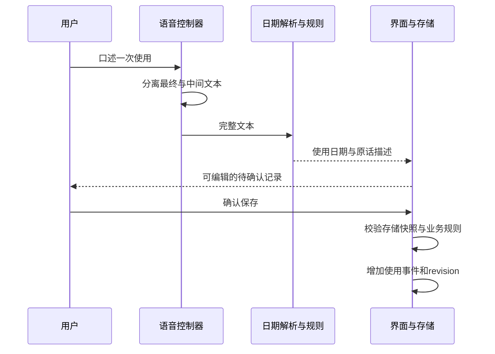

# v13技术架构与数据模型

当前只维护权益名称、分类、服务方与期限，使用记录为可选功能；无金额或次数计算。原生ES Modules将界面、日期规则、语音会话与业务校验分开。

## 输入与确认

所有权益类型共用同一流程。金额出现在描述中时只保留文字，不汇总或扣减；明确校正余额、充值或退款等请求会被拒绝。

## 数据模型与兼容

| 对象 | 当前字段 | 作用 |
| --- | --- | --- |
| Card | id、name、type、provider、start、end、noExpiry、notes、archived、revision | 权益与期限 |
| Event | id、cardId、kind=use、date、note、revisionAfter、undone、source、createdAt | 使用记录与撤销约束 |
| State | cards、events、demo | 本地状态与示例模式 |

新Card没有quantity和verified；新Event没有debit及前后余量。为兼容旧数据，校验器允许符合旧规则的这些字段存在，并原样保留。旧扣减或校正事件由isLegacyAccounting识别，只读回顾、不恢复余额。校验旧数字之间的关系只是验证历史格式，不提供新的记账能力。

沿用原存储键，不在加载时写回或清空数据；正常编辑通过保留旧对象字段的方式维护兼容。原始备注可能含历史金额，不自动删除用户文字。

## 一致性与边界

- 日期必须真实存在，使用不能在未来或权益有效期外。
- 编辑、归档、打卡和撤销推进revision；只有版本匹配的新使用记录可撤销。
- 编辑和打卡面板保存打开时的存储快照，提交前发现变化会拒绝覆盖。检查与写入不具备原子性，也没有解决完整并发合并。
- 旧状态读取或校验失败时暂停保存，写入失败时不提示成功。
- 用户内容使用textContent呈现；语音旧会话通过token失效，不覆盖手动修改。
- 期限按日期字符串计算日差，日期规则可使用固定today参数测试；未知与长期有效分别建模。

数据不跨浏览器来源共享。没有账号、服务端、云同步或后台通知；语音识别服务可用性需要真实设备确认。
