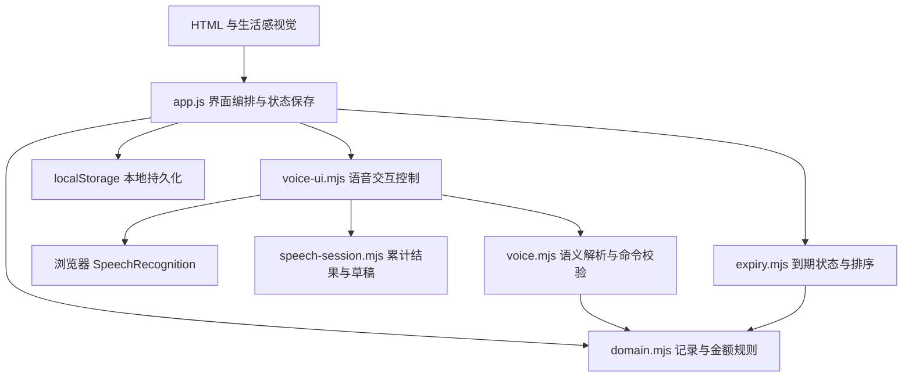
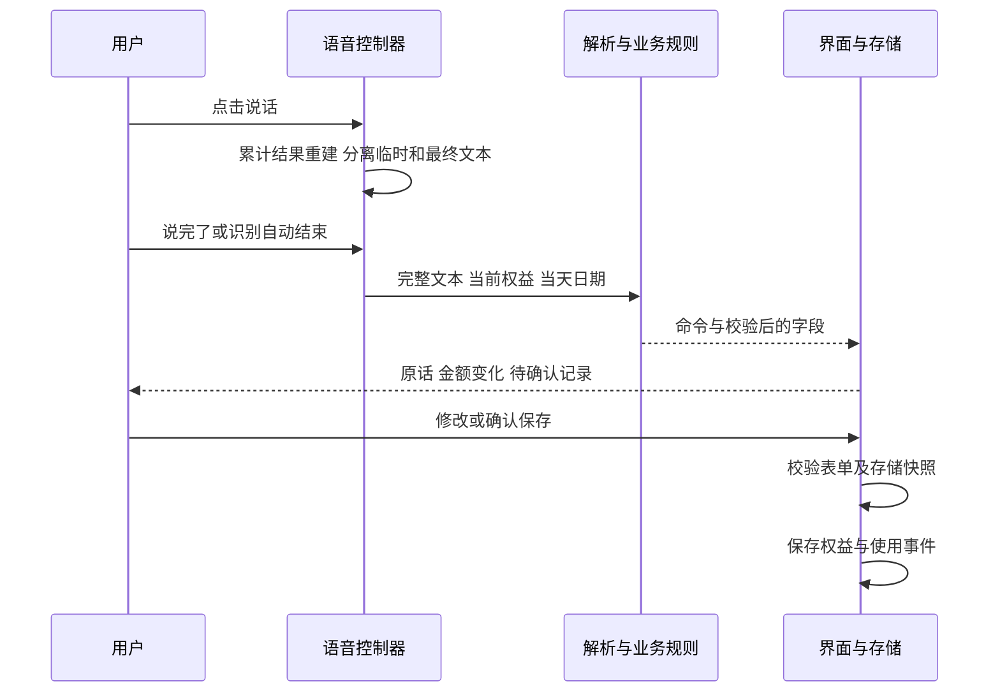

# 技术架构与数据模型

应用以原生ES Modules组织。界面编排、日期规则、记录规则、语音会话与语义解析分开，使规则能够在不启动真实浏览器或麦克风的情况下检查。

## 模块关系

这是一套浏览器端应用，没有服务端数据库。localStorage属于当前来源和浏览器；本地地址和线上域名之间不共享记录。

## 记录管线

语音结果只回填字段。解析失败时阻止直接提交，用户可以改为手动填写。手动编辑会作废旧会话，避免迟到回调覆盖新内容。

## 核心数据

| 对象 | 关键字段 | 用途 |
| --- | --- | --- |
| 权益Card | id、type、name、provider、start、end、noExpiry、quantity、revision、archived | 描述权益、期限与本地余量 |
| 记录Event | cardId、date、note、debit、previousQuantity、afterQuantity、revisionAfter、undone、source | 留下使用或校正记录，约束撤销 |
| 应用状态 | cards、events、demo | 将权益与事件一起保存，并显式区分示例体验 |

储值金额以整数分保存。例如35.5元对应3550分，规则运算不直接使用带小数的元。界面展示时再转为元。

次卡的quantity可以为null；历史次数为兼容旧数据而保留。当前界面不展示或维护次数，次卡打卡不扣减旧值。领域模块仍保留早期次数能力，不能将其等同于当前对外功能。

## 一致性与故障处理

- **输入边界**：校验真实日期、有效期区间、金额精度和上限；拒绝超额扣减及未来使用记录。
- **撤销约束**：当前权益revision必须与记录的revisionAfter一致；后续有相关修改时不盲目恢复旧余额。
- **过期表单保护**：打开记录面板时保存存储快照；提交前快照变化则拒绝覆盖，要求重新打开。它不是数据库事务，也不提供跨标签页原子写入或合并能力。
- **读取异常**：无法解析或校验已有状态时暂停写入，避免把异常数据覆盖为空列表。
- **保存异常**：本地保存失败时不将新状态标记为成功。
- **内容呈现**：使用textContent等DOM接口呈现用户文本，避免把记录当成HTML直接插入。

## 日期规则

以本地当天日期作为业务输入，再将日期字符串按UTC零点计算日差，减少按实际经过小时计算带来的误差。日期函数不依赖测试运行时的当前时间，边界场景可以固定日期验证。

未知日期和长期有效分别建模；过期项、有效项与概览统计共享同组规则。颜色之外同时给出文字标签和剩余天数。

## 当前取舍

无第三方前端运行依赖，静态目录即可部署；相应代价是没有账户、备份或跨设备同步。语音依赖浏览器识别服务，接口可用不保证服务在所有设备或网络上可用。规则解析覆盖有限语义，复杂优惠、退款或不明确操作需要人工核对。
